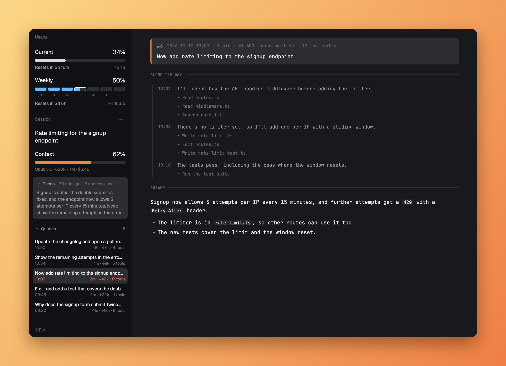

# Claude Code Usage & History for Herdr

See your Claude Code conversation at a glance in [Herdr](https://herdr.dev)'s sidebar: its title,
Claude's own recap of where it stands, how full the context is, how close you are to your limits,
and every query you sent. Click a query to read what Claude did and answered, without scrolling the
terminal.



It only reads files on your computer, so it uses no tokens and sends nothing anywhere.

## What you get

- **Usage:** your 5-hour and weekly limits, and when they reset. The weekly bar has a segment per day, so you can see if you're ahead of an even pace.
- **Session:** the conversation's title, context, model and cost, Claude Code's recap, Claude's live status, and your queries, newest first, with time, duration, tokens and tools. The ⋯ menu shows or hides the title, context, recap and queries; the recap and queries also fold.
- **Query pages:** click a query to open it beside the terminal: your prompt, what Claude did along the way, and its answer.

## Install

You need Herdr, Claude Code and Python 3.9 or newer.

**1. Copy the mods**

```sh
git clone https://github.com/jgrecoarroyo/herdr-claude-session.git
cp -R herdr-claude-session/mods/* ~/.config/herdr-app/mods/
```

**2. Add the sections to your layout**

Herdr's own layouts are read-only, so if you're on one, clone it first:

```sh
herdr-app do layout.clone '{"name":"main","as":"my-layout"}'
```

In `~/.config/herdr-app/layouts/my-layout.json`, add these to the column that holds `spaces` and `agents`:

```json
{ "id": "usage", "type": "block", "size": { "px": 214 }, "min": 42, "content": { "mod": "claude-usage" } },
{ "id": "session", "type": "block", "size": { "weight": 1.6 }, "min": 42, "content": { "mod": "claude-session" } }
```

**3. Save Claude Code's data**

Claude Code hands this data to its status line, so a small script saves it. In `~/.claude/settings.json`:

```json
"statusLine": { "type": "command", "command": "python3 ~/.config/herdr-app/mods/claude-session/snapshot.py" }
```

This status line shows nothing. To keep your own, pass its command as an argument:

```json
"statusLine": { "type": "command", "command": "python3 ~/.config/herdr-app/mods/claude-session/snapshot.py \"bash ~/.claude/my-statusline.sh\"" }
```

The sections fill in after Claude's next reply.

## Good to know

- **Which conversation:** Session follows the focused terminal. Clicking a pane that isn't a terminal (like a query page) keeps the conversation it showed, as long as it's in the same space.
- **Recap:** Claude Code writes one when you come back to a session after a while, so not every conversation has one, and it can be behind: it says how many queries came after it, in amber from 10.
- **Collapsed sidebar:** under 160 px, Usage and Session shrink to a small stack for each number: a five-segment bar, the percentage and a label (`5h`, `7d`, `ctx`). Hover one for the details.
- **Limits:** Claude Code only reports them for Pro, Max and Ultra subscribers, or behind a Claude apps gateway with a spend limit. Otherwise Usage stays empty.
- **Platforms:** tested on macOS. Linux should work but hasn't been tested. Windows isn't supported.
- **Local only:** it follows Claude Code running on this computer, not on other Herdr machines.
- **Updates:** Session reads Claude Code's own session and transcript files, which aren't a documented format. A Claude Code update could break it.
- **Privacy:** query pages and caches hold your conversation text. They're in `~/.cache/herdr-claude-session`, readable only by you.
- **Context colors:** the bar is white, orange from 50% and red from 80%. To change that, add `"props": { "context": { "warn": 60, "danger": 90 } }` to the Session block's content.
- **Folding (optional):** to fold a section by clicking its title, add its block id to the block's content: `"props": { "fold": "session" }`. It sizes sections with fixed heights, so it can disturb the sections around it.

## License

[MIT](LICENSE)
