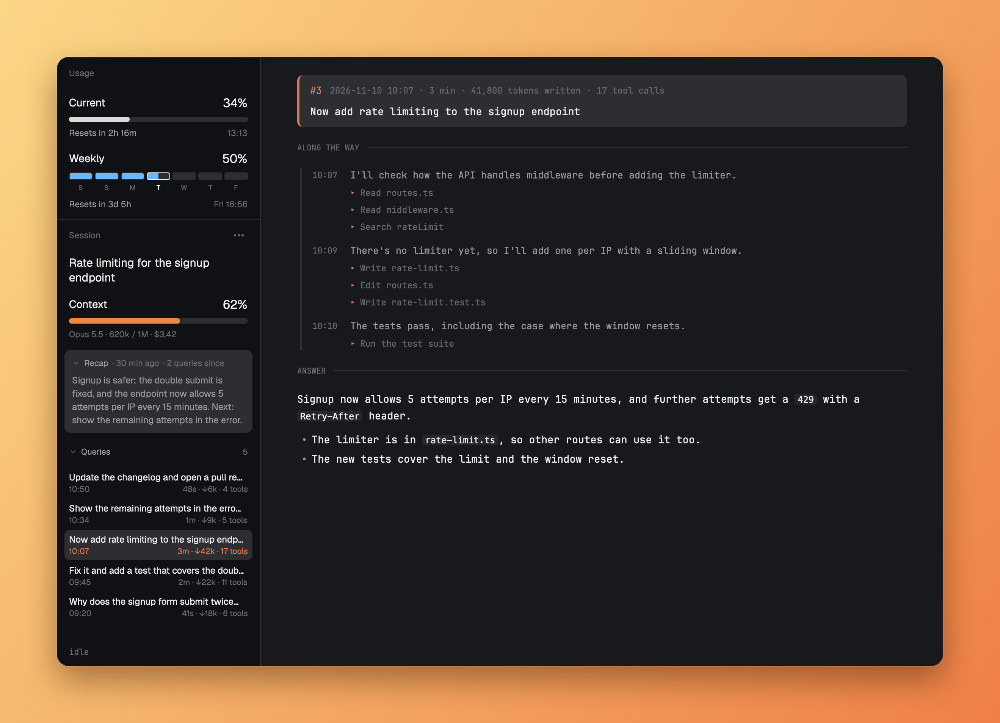

# Claude Code Usage & History

Two sidebar sections and a page for the Claude Code conversation in the focused terminal. **Usage** shows the account's 5-hour and weekly limits. **Session** shows the conversation's title, context, model, cost, Claude Code's own recap, live status and every query sent. Clicking a query opens it in a pane beside the terminal as a timeline ending in Claude's answer. It reads local files only and uses no tokens.

## What you see

**Usage**, a block 214 px tall in the sidebar, on the theme's `chrome` with a 1 px `border` line on top:

- A 41 px header: "Usage", 11.5 px, medium, `dim`, 16 px from the left.
- **Current** (the 5-hour window): label 14 px on the left, percentage 16 px on the right, both `foreground`. Below, a 7 px bar with radius 4 on a `raised` track, filled `#dbdbdb` in dark themes and `foreground` in light ones. Below that, 11.5 px: "Resets in 2h 17m" in `muted` on the left, the clock time in `dim` on the right ("13:09" today, else "Sat 14:00").
- **Weekly** (the 7-day window): the same head and note, with 7 segments instead of a bar: 10 px tall, radius 3, 3 px apart, each with a day letter below at 9 px, counted from today, so today's segment always shows today's letter. The fill runs through them in `#6cb6ff`. Today's segment has a `foreground` outline and letter. Fill past today is `#e3b341`.
- Any bar at 90% or more fills `#e5534b`.
- With no data: "Limits show after Claude's next reply." in 11 px `dim`.

**Session**, a block below it taking the remaining height:

- The same 41 px header, reading "Session", with a ⋯ button at its right: three 3 px `dim` dots, 2 px apart, in a 24×22 px target that gets `hover` on hover. It opens a 180 px popup under its right edge with a checkbox row per part: Title, Context, Recap, Queries. Rows are 30 px, radius 7; a checked box is 15 px `accent` with radius 4 and the shipped `check.svg` in `accent_foreground`, an unchecked one a 1 px `input` outline.
- **Title:** Claude Code's AI title for the conversation, 15 px semibold `foreground`, line height 1.3, wrapping, 8 px above Context.
- **Context:** the same head, a 7 px bar that fills white (`#dbdbdb`, `foreground` in light themes), `#f0883e` from 50% and `#e5484d` from 80%, and an 11 px `dim` line: "Opus 5.5 · 372k / 1M · $3.42", plus "2× compacted" when it applies.
- **Recap**, only when the conversation has one: a card on `raised`, radius 8, 8/10 px padding. Its top line at 11 px: a chevron, "Recap" semibold `muted`, then "· 8 d ago" and "· 29 queries since" in `dim`, the count in `#e8a04a` from 10. Below, the recap at 12 px `muted`, line height 1.45.
- **Queries:** a chevron and an 11 px semibold `muted` title with the count on the right in `dim`, then a scrolling list, newest first. Each row has radius 7 and 5/6 px padding: the first line of the prompt at 12 px truncated, and under it at 10.5 px the time on the left and "3m · ↓41k · 17 tools" on the right.
- **Status:** a 22 px line at the bottom in the mono font: a spinning "✻" and Claude's word in `#e8a04a` at 12.5 px, with elapsed time and tokens at 10.5 px `dim`, shortened with "…" when narrow.

**A query page**, a pane on the terminal's right on the theme's `background`, centered to at most 860 px, in the mono font:

- The query in a `raised` card, radius 8, with a 3 px `#d97757` left edge: number, a meta line (date, time, duration, tokens, tool calls) and the prompt.
- "ALONG THE WAY" at 10.5 px with a rule, then a timeline with a 2 px `border` line: the time, Claude's comment in 12.5 px `muted`, and its actions at 11.5 px `dim`, each after a `#d97757` "▸".
- "ANSWER" with a rule, then the answer as rendered Markdown at 13.5 px.

**When the sidebar is narrower than 160 px** (Herdr collapses it to 44 px), both sections drop their titles, bars and query rows. Each number is a centered stack: five segments, each 5×4 px and 20% of the range, lit as soon as that stretch is in use, in the bar's color or `#e5484d` from 90%; 5 px below, the percentage at 13 px bold, with its label right under it at 11 px `muted` (`5h`, `7d`, `ctx`). 20 px separates the stacks. Session adds the query count, labeled `qs`, and a status at the bottom: the spinning "✻" in `#e8a04a` while working, "!" when blocked, "·" otherwise. Tooltips hold the details.

## How it behaves

- **Which conversation:** the focused terminal's, whatever Herdr calls it: `session.py` checks which Claude Code process runs there. With a pane that isn't a terminal focused (a query page), the conversation shown last if it's in the focused space, else that space's first Claude Code agent. Never another space's, and nothing when the focused terminal runs no Claude Code. What was read for each terminal is kept, so switching back shows it at once; focus is checked every 300 ms. Terminals on other machines are skipped. Usage isn't tied to a terminal: limits are per account, so it reads the newest snapshot of any session.
- **working:** the newest query row, if unfinished, gets a `raised` background, its number and info line turn `#d97757`, and its time reads "working". The status line shows Claude's spinner word.
- **blocked:** the status line reads "waiting for you" in 11 px `dim`.
- **done, idle:** the status line reads "idle".
- **Hover:** query rows get a `raised` background.
- **Click a query:** the row stays highlighted like a running one. The page opens in a new pane on the right, or replaces the page in this tab's query pane if it has one. A page shows the query as it was when clicked; it doesn't update live.
- **Links on a page:** http and https links open in the browser. Other links do nothing.
- **Limits that have ended:** the 5-hour window reads 0% and "Reset at 13:09". The weekly window reads 0% and moves on to its next week.
- **Refresh:** Session every 3 s and its status every 1.5 s, Usage every 5 s, the "Resets in" text every minute.
- **⋯ menu:** each click shows or hides that part at once, and the menu stays open. The choice is in shared `claude-session.hide` (`{title, context, recap, queries}`, true when hidden), so it holds across restarts. With Queries hidden, the status line stays at the bottom.
- **Recap and Queries fold** by clicking their heading line; each copy remembers which are open in `localStorage`.
- **Folding, off by default:** with the prop `"fold": "<block id>"`, the title shows a chevron and clicking it folds the block to a 42 px header with `layout.resize`.

## Built from

- **`mods/claude-usage`:** `main.js` and `usage.py`. Mod block in the sidebar column, optional prop `fold`.
- **`mods/claude-session`:** `main.js`, `session.py` and `snapshot.py`. Mod block in the sidebar column, optional props `fold` and `context` (`{warn, danger}`, percentages).
- **`mods/claude-query`:** `main.js` and `exchange.js`. Opened with `pane.split {direction: "right", mod: "claude-query", props: {file}}`, never placed in a layout.
- **`accordion.js`** in Usage and Session handles folding, using `layout.resize` and shared `sidebar.sections`, and draws the shipped `mods/workspace-chrome/chevron-*.svg`.
- **Layout:** two blocks added to the column holding `spaces` and `agents`, in a clone of `main`.
- **Herdr functions:** `agents`, `focused`, `panes`, `spaces`, `exec`, `hc`, `run`, `theme`, `settings`, `props`, `shared`, `setShared`, `openOverlay`, `nextCommand`, `readTextFile`, `window`, `appHome`, `layout`.
- **The ⋯ menu** is `claude-session` itself opened with `openOverlay({kind: "popup", props: {menu: true}})`: with that prop it draws only the checkboxes.
- **Commands:** `pane.split`, `layout.resize`, and `claude-query.show` to the shown copy, after Session puts the path in shared `claude-query.file`.
- **Programs:** `python3`, 3.9 or newer. `ps` on macOS, `/proc` on Linux. `open` or `xdg-open` for web links. `hc read` for the spinner word.
- **Files read:**
  - `~/.claude/sessions/<pid>.json` for the session, matched through `HC_TERMINAL_ID` in the process's environment.
  - The transcript JSONL under `~/.claude/projects/`, read from where the last run stopped: prompts, the `ai-title` record for the title, and the newest `away_summary` system record for the recap.
  - `~/.cache/claude-statusline/<session>.json`, written by `snapshot.py`.
- **Files written:** the snapshots, plus caches and pages in `~/.cache/herdr-claude-session`, all readable only by the user.
- **Status line:** `~/.claude/settings.json` runs `snapshot.py`. With a command as its argument, it also runs that status line with the same input and shows its output.

## Watch out

- `rate_limits` appears only for claude.ai Pro, Max and Ultra subscribers, or behind a Claude apps gateway with a spend limit, and only after the first reply. Claude Code drops a window once it has ended, so a saved snapshot can be older than the window.
- The session files and transcript format are Claude Code's own and undocumented. Fields used include `origin.kind`, `turnPosition.promptIndex`, `isSidechain` and the `turn_duration` system record. Messages queued mid-turn don't appear as prompts.
- A week runs reset to reset, so each segment spans two calendar days. Labeling a segment by the day it starts or ends on shows the wrong day for part of each day.
- Claude Code writes a recap only when you come back to a session after a while, so many conversations have none, and it can be far behind. It ends some with "(disable recaps in /config)", which `session.py` drops.
- Herdr's agent list can label a Claude Code terminal as a plain shell. Picking the conversation from that list showed another space's; `session.py` matches processes by `HC_TERMINAL_ID` instead, with a single `ps` for all of them.
- `snapshot.py` replaces any existing status line unless its command is passed as the argument.
- GPUI quirks in Herdr: `on_size_change` works only on a mod's root, `v_virtual_list` rows didn't render, `TextView` ignores `text_color` and `text_size`, and negative margins are ignored.
- Geist has no bold in Herdr, so labels stand out by size and color rather than weight.
- Folding sets fixed heights, so it can disturb neighboring sections. That's why it's off by default.
- Tested on macOS only. The Linux paths haven't been run. Windows isn't supported.

## Done when

- `herdr-app check` passes for `claude-session`, `claude-usage` and `claude-query`.
- After a Claude Code reply, Session shows the context percentage, model and cost, and Usage shows both limits on a subscriber account.
- Sending a prompt adds a row with "working" and the spinner word; when it finishes, the row shows its time, duration, tokens and tools.
- Clicking a query opens its page on the right. Clicking another replaces it in the same pane.
- `snapshot.py "<command>"` still shows that command's output.
- Moving focus to another terminal running Claude Code switches Session to that conversation, including its title and recap; moving to one without a recap shows none.
- Focusing a terminal without Claude Code shows "No Claude Code conversation in this terminal.", not the previous conversation.
- Unchecking a part in the ⋯ menu hides it at once, and it stays hidden after a restart.
